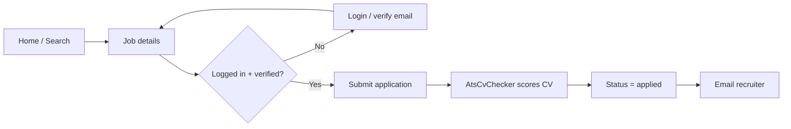
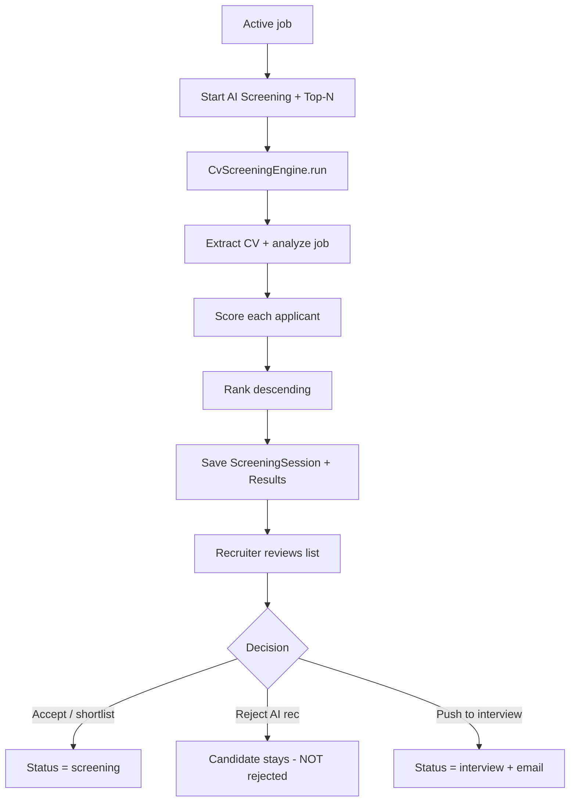
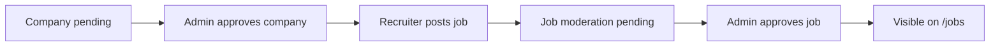
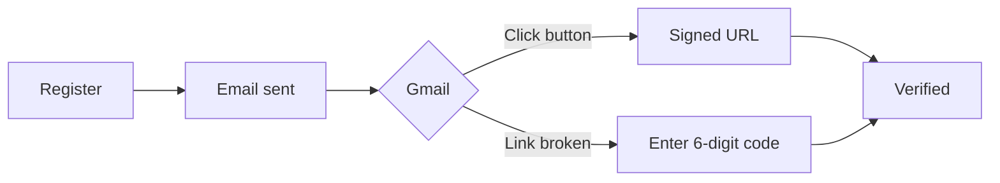

# RecruitPro — Internship / Practicum Defense Guide

Use this file during viva. If a board member asks **“ei jinish tar logic koi?”**, jump to [Section 5](#5-feature-map--logic-koi). If they ask **“same feature implement korte hole ki ki file?”**, use [Section 6](#6-how-to-implement-a-similar-new-feature).

---

## 1. One-minute project pitch

**RecruitPro** is a role-based Internship & Job Portal.

| Actor | What they do |
|---|---|
| **Student / Candidate** | Build profile, upload CV, search jobs, apply, track status, attend interviews |
| **Recruiter** | Post jobs, review applications, run **AI CV screening**, shortlist, schedule interviews, send offers |
| **Admin** | Approve companies/jobs, manage users, view reports (CSV/PDF), security & permissions |

**Highlight feature (likely the main viva topic):** AI-Based CV Screening — PDF validation, CV parsing, job-requirement analysis, percentage match score, ranking, AI explanation, recruiter override (no auto-reject).

**Stack:** Laravel 12, PHP 8.2+, Blade + Bootstrap 5, vanilla JavaScript, SQLite (default) / MySQL, Spatie Permission, DomPDF, `smalot/pdfparser`.

---

## 2. How a request travels (say this in viva)

```
Browser
  → public/index.php
  → bootstrap/app.php          (middleware aliases: role, permission, verified)
  → Modules/{Name}/Routes/web.php
  → Form Request (validation)
  → Controller (HTTP only)
  → Service (business logic) + Model (database)
  → Notification / redirect
  → resources/views/*.blade.php
```

**Important sentence for the board:**

> Controllers handle HTTP. Business logic lives in `app/Services`. Data lives in `app/Models`. Routes live in `Modules/*/Routes`. Views live in `resources/views`.

`routes/web.php` is almost empty. Modules are registered in `Modules/Support/ModulesServiceProvider.php`. Each module’s `*ServiceProvider` loads its own `Routes/web.php`.

---

## 3. Project file structure (what lives where)

```
recruitpro/
├── app/                          # Shared domain (used by every module)
│   ├── Console/Commands/         # Scheduled jobs (job alerts, interview reminders)
│   ├── Enums/                    # Fixed values: roles, statuses (not magic strings)
│   ├── Events/                   # e.g. MessageSent (chat broadcast)
│   ├── Http/
│   │   ├── Controllers/          # Only shared: MediaController (photos/CVs)
│   │   ├── Middleware/           # RBAC, blocked-user check, locale
│   │   └── Requests/             # Form validation rules
│   ├── Models/                   # Eloquent tables (User, JobPosting, Application…)
│   ├── Notifications/            # Email + database notifications
│   ├── Policies/                 # “Can this user update this job/application?”
│   ├── Providers/AppServiceProvider.php
│   └── Services/                 # ★ CORE LOGIC (screening, ATS, matching, PDF extract)
│
├── Modules/                      # Feature modules (routes + controllers)
│   ├── Auth/                     # Login, register, email verify, password reset
│   ├── Profiles/                 # Student profile builder + candidate public profile
│   ├── Companies/                # Recruiter company profile
│   ├── Jobs/                     # Job search, post, manage, saved jobs, alerts
│   ├── Applications/             # Apply + recruiter ATS list + AI screening
│   ├── Interviews/               # Schedule / status interviews
│   ├── Messaging/                # In-app chat
│   ├── Admin/                    # Users, companies, jobs, reports, permissions
│   ├── Core/                     # Home, dashboards, settings, media files
│   ├── Api/                      # REST JSON API (Sanctum tokens)
│   ├── Security/                 # 2FA + security headers
│   ├── Privacy/                  # Data export / account delete (GDPR-style)
│   ├── Growth/                   # Extra: portfolio, assessments, offers, talent pool
│   └── Support/                  # Module loader (not a user feature)
│
├── bootstrap/app.php             # App bootstrap, middleware aliases
├── config/                       # mail, filesystems, permission, scout…
├── database/
│   ├── migrations/               # Table schemas
│   ├── seeders/                  # Demo users + roles/permissions
│   └── factories/                # Test user factory
├── public/                       # Web root (css/, js/, index.php)
├── resources/views/              # Blade UI (all screens)
├── routes/                       # web.php empty; console.php = scheduler
├── tests/Feature/                # Automated tests
└── DEFENSE.md                    # This file
```

### `app/` vs `Modules/` — viva answer

| Question | Answer |
|---|---|
| Why both? | **Modules** = HTTP (routes + controllers per feature). **`app/`** = shared models, services, enums used by many modules. |
| Where is screening logic? | `app/Services/CvScreeningEngine.php` — **not** in the controller. |
| Where is the screening button handled? | `Modules/Applications/Http/Controllers/ScreeningController.php` |

---

## 4. Roles, middleware, permissions

### 4.1 Three roles

Defined in `app/Enums/UserRole.php`:

| Role | Dashboard route | After login goes to |
|---|---|---|
| `student` | `student.dashboard` | `/student/dashboard` |
| `recruiter` | `recruiter.dashboard` | `/recruiter/dashboard` |
| `admin` | `admin.index` | `/admin` |

### 4.2 Middleware (security layers)

Registered in `bootstrap/app.php`:

| Alias | File | Job |
|---|---|---|
| `auth` | Laravel built-in | Must be logged in |
| `verified` | Laravel built-in | Email must be verified |
| `role:student` (etc.) | `app/Http/Middleware/EnsureUserHasRole.php` | Wrong role → 403 |
| `permission:…` | Spatie | Fine-grained (e.g. `applications.review`) |
| `active` / web group | `EnsureUserIsActive.php` | Blocked users kicked out |
| throttle | Laravel | Login/register limited to 5 attempts / minute |

**Viva line:** “A student cannot open `/admin` because the route uses `role:admin`. Even if they guess the URL, middleware returns 403.”

### 4.3 Recruiter permissions (Spatie)

Seeded in `database/seeders/RolesAndPermissionsSeeder.php`:

- Recruiter: `applications.review`, `interviews.manage`, `messages.use`, `talent.view`
- Student: `messages.use`
- Admin: all permissions

---

## 5. Feature map — “logic koi?”

For each feature: **entry (route/UI) → controller → logic → data → view**.

### 5.1 Authentication (login / register / verify email)

| Layer | File |
|---|---|
| UI | `resources/views/auth/login.blade.php`, `verify-email.blade.php` |
| Routes | `Modules/Auth/Routes/web.php` |
| Controller | `Modules/Auth/Http/Controllers/AuthController.php` |
| Validation | `app/Http/Requests/Auth/LoginRequest.php`, `RegisterRequest.php` |
| User model | `app/Models/User.php` (`MustVerifyEmail`) |
| Verify email | `app/Notifications/VerifyEmailNotification.php` |
| Verify code | `AuthController::verifyWithCode` + cache key `email-verify-code:{userId}` |

**Flow:** Register → `Registered` event → email with **button + 6-digit code** → user clicks link **or** types code → `email_verified_at` set → dashboard.

**Gmail:** signed URL can wrap in Gmail; 6-digit code is the fallback. SMTP settings in `.env` (`MAIL_HOST=smtp.gmail.com`).

---

### 5.2 Home page & job search

| Layer | File |
|---|---|
| Home UI + Find Jobs filters | `resources/views/home/index.blade.php` |
| Home controller | `Modules/Core/Http/Controllers/DashboardController.php` → `home()` |
| Job list UI | `resources/views/jobs/search.blade.php` |
| Job detail | `resources/views/jobs/show.blade.php` |
| Search logic | `Modules/Jobs/Http/Controllers/JobPostingController.php` → `index()` |
| Filters | Query params: `q`, `location`, `category[]`, `job_type[]`, `location_type[]` |
| CSS (no clipping) | `public/css/recruitpro.css` (`.home-job-filters`, `.filter-sidebar`) |

Only **active + admin-approved + not expired** jobs show (`JobPosting::scopeActive()`).

---

### 5.3 Student profile & CV upload

| Layer | File |
|---|---|
| UI | `resources/views/profile/builder.blade.php` |
| Routes | `Modules/Profiles/Routes/web.php` |
| Controller | `Modules/Profiles/Http/Controllers/ProfileController.php` |
| Validation | `Modules/Profiles/Http/Requests/UpdateProfileRequest.php` |
| Model | `app/Models/Profile.php` (skills, education, experience JSON; `avatarUrl()`) |
| PDF text extract | `app/Services/ResumeTextExtractor.php` |
| Photo serving | `app/Http/Controllers/MediaController.php` + route `/media/{path}` |

Completeness score: `Profile::calculateCompleteness()`.

---

### 5.4 Recruiter posts a job

| Layer | File |
|---|---|
| Form UI | `resources/views/jobs/_form.blade.php`, `post.blade.php`, `edit.blade.php` |
| Controller | `Modules/Jobs/Http/Controllers/JobPostingController.php` |
| Validation | `Modules/Jobs/Http/Requests/StoreJobPostingRequest.php` |
| Policy | `app/Policies/JobPostingPolicy.php` |
| Model | `app/Models/JobPosting.php` |
| Company must be approved | `Company::isApproved()` — admin moderates in Admin module |

Job statuses (`app/Enums/JobStatus.php`): `draft` / `active` / `closed`.  
Moderation (`ModerationStatus`): `pending` / `approved` / `rejected`.

---

### 5.5 Student applies to a job

| Layer | File |
|---|---|
| Apply form | `resources/views/jobs/show.blade.php` |
| Controller | `Modules/Applications/Http/Controllers/ApplicationController.php` → `store()` |
| Validation | `app/Http/Requests/StoreApplicationRequest.php` |
| Model | `app/Models/Application.php` |
| First ATS score | `app/Services/AtsCvChecker.php` → `applyToApplication()` |
| Email recruiter | `app/Notifications/NewApplicationReceived.php` |
| Unique constraint | one application per user per job (DB unique + controller check) |

Pipeline statuses (`app/Enums/ApplicationStatus.php`):

`applied` → `screening` → `interview` → `offer` → `hired`  
or `rejected` / `withdrawn`

---

### 5.6 AI-Based CV Screening (MAIN FEATURE)

**This is the feature to defend in depth.**

| Layer | File | What it does |
|---|---|---|
| Start button | Recruiter dashboard, job manage, `resources/views/screening/index.blade.php` | Recruiter clicks **Start AI Screening** + Top 5/10/15 |
| Routes | `Modules/Applications/Routes/web.php` | `screening.store`, `show`, `candidate`, `decide`, `interview` |
| Controller | `Modules/Applications/Http/Controllers/ScreeningController.php` | HTTP only: authorize, call engine, save decision |
| **Engine** | **`app/Services/CvScreeningEngine.php`** | ★ Score, rank, explanation |
| PDF validate/extract | `app/Services/ResumeTextExtractor.php` | `%PDF` header check, parse text |
| Parse CV sections | `app/Services/CandidateProfileExtractor.php` | Education, skills, experience, projects, certs, tools, languages |
| Parse job | `app/Services/JobRequirementAnalyzer.php` | Required/preferred skills, education, experience, location |
| Keyword ATS (older) | `app/Services/AtsCvChecker.php` | Keyword hit-rate on apply / rescan |
| Tables | Migration `2026_08_28_000001_create_ai_cv_screening_tables.php` | sessions, results, decisions |
| Models | `ScreeningSession`, `ScreeningResult`, `ScreeningDecision` | History + recruiter override |
| Results UI | `resources/views/screening/show.blade.php` | Top-N dropdown, ranked table |
| Detail UI | `resources/views/screening/candidate.blade.php` | Full CV, extracted data, accept/reject AI, interview |

#### Scoring formula (memorize this)

```
overall = required_skills×40% + preferred_skills×15% + education×15%
        + experience×20% + location×10%
```

Each category is 0–100. Overall is clamped 0–100. Candidates sorted **descending by score** → `rank` 1, 2, 3…

Match types:

- **Matched** — term (or alias, e.g. JS → JavaScript) found in CV/profile
- **Partial** — related token found, not exact
- **Missing** — not found

AI recommendation text:

- ≥ 75% → “Recommended for shortlist”
- ≥ 50% → “Possible shortlist after manual review”
- else → “Not auto-recommended” — **still not rejected**

**Critical viva sentence:**

> The system never auto-rejects. AI only ranks and explains. Recruiter decisions are stored in `screening_decisions`, separate from AI output in `screening_results`.

Top-N is a **display filter**, not a delete. Candidates outside Top-N stay visible under “Other applicants” and can still be shortlisted.

---

### 5.7 Interviews & email

| Layer | File |
|---|---|
| UI | `resources/views/interviews/index.blade.php` |
| Controller | `Modules/Interviews/Http/Controllers/InterviewController.php` |
| Also from screening | `ScreeningController::pushToInterview()` |
| Email (immediate, not queued) | `app/Notifications/InterviewScheduled.php` |
| Reminder (cron) | `app/Notifications/InterviewReminder.php` + `app/Console/Commands/SendDeadlineReminders.php` |
| Schedule | `routes/console.php` — daily 09:00 |

When an interview is created: application status → `interview`, candidate gets email.

---

### 5.8 Recruiter dashboard (kanban pipeline)

| Layer | File |
|---|---|
| UI | `resources/views/recruiter/dashboard.blade.php` |
| Data | `DashboardController::recruiter()` |
| Drag-and-drop API | `POST/PATCH /applications/{id}/pipeline` → `ApplicationController::updatePipeline` |

---

### 5.9 Admin reports (PDF)

| Layer | File |
|---|---|
| Page | `resources/views/admin/reports.blade.php` |
| Controller | `Modules/Admin/Http/Controllers/AdminController.php` → `reports()`, `exportReport()`, `exportReportPdf()` |
| PDF template | `resources/views/admin/report-pdf.blade.php` |
| Library | `barryvdh/laravel-dompdf` |

Monthly counts use SQLite `strftime` vs MySQL `DATE_FORMAT` (driver-aware). Status grouping uses **string keys**, not PHP enums (that was the report crash).

---

### 5.10 Messaging

| Layer | File |
|---|---|
| Controller | `Modules/Messaging/Http/Controllers/MessageController.php` |
| Event | `app/Events/MessageSent.php` |
| Notification | `app/Notifications/NewMessageReceived.php` |

---

### 5.11 Extra student features (Growth module)

All in `Modules/Growth/Http/Controllers/GrowthController.php` + `Modules/Growth/Routes/web.php`:

Portfolio, resume PDF, skill assessments, job recommendations (`JobMatchService`), company follow/reviews, offers.

**Note:** Blog, Team, Stages, Review, CMS, Plans, Feature Flags still have **routes/controllers** but were **removed from the sidebars** for the current product UI.

---

## 6. How to implement a similar new feature

Board: *“If you add ‘AI interview scoring’, which files?”*

Use this **same 8-step pattern** as CV screening:

| Step | What | Example files |
|---|---|---|
| 1 | Migration (tables) | `database/migrations/xxxx_create_….php` |
| 2 | Enum if needed | `app/Enums/….php` |
| 3 | Models + relations | `app/Models/….php` — also add `hasMany` on `User` / `JobPosting` |
| 4 | **Service (logic)** | `app/Services/….php` |
| 5 | Controller | `Modules/{Feature}/Http/Controllers/….php` |
| 6 | Routes + middleware | `Modules/{Feature}/Routes/web.php` (`auth`, `verified`, `role:`) |
| 7 | Blade views | `resources/views/{feature}/*.blade.php` + sidebar link |
| 8 | Notification / test | `app/Notifications/….php`, `tests/Feature/….php` |

**Do not** put scoring math in the Blade file or in the controller. Put it in a Service so it can be tested and reused.

### Copy-paste checklist (new recruiter feature)

1. Route under `role:recruiter,admin` + a Spatie permission if needed  
2. `abort_unless($job->user_id === $user->id)` so recruiters cannot see others’ jobs  
3. Policy if the resource is an Application / JobPosting  
4. Sidebar: `resources/views/partials/sidebar-recruiter.blade.php`  
5. Feature test with `RefreshDatabase`

---

## 7. Workflows (draw these on the board if asked)

### 7.1 Student: find job → apply



### 7.2 Recruiter: AI screening → interview



### 7.3 Recruiter posts a job



### 7.4 Email verification



---

## 8. Database (tables you should name in viva)

| Table | Purpose |
|---|---|
| `users` | Account + `role`, `email_verified_at`, `is_blocked` |
| `profiles` | Student CV fields, `resume_path`, `resume_text`, `avatar_path` |
| `companies` | Recruiter company; `status` pending/approved |
| `job_postings` | Jobs; `skills`, `ats_keywords`, `status`, `moderation_status` |
| `applications` | Apply record; `status`, `match_score`, ATS keyword JSON |
| `screening_sessions` | One AI run: job, recruiter, `top_n`, `job_requirements` |
| `screening_results` | Per-candidate score, rank, explanation, extracted profile |
| `screening_decisions` | Recruiter override (independent of AI) |
| `interviews` | Schedule, mode, link |
| `messages` / `conversations` | Chat |
| `activity_logs` / `security_events` | Audit |
| `permissions` / `roles` | Spatie RBAC |

Relations (short):

- User 1—1 Profile, 1—1 Company (recruiter)
- User 1—N JobPostings, Applications, Interviews
- JobPosting 1—N Applications, ScreeningSessions
- ScreeningSession 1—N ScreeningResults 1—N ScreeningDecisions

---

## 9. Modules → controllers (quick index)

| Module | Controller | Responsibility |
|---|---|---|
| Auth | `AuthController` | Login, register, verify, reset |
| Core | `DashboardController` | `/`, student/recruiter dashboards, settings |
| Core | `MediaController` | Serve `/media/{path}` images |
| Jobs | `JobPostingController` | CRUD + public search |
| Jobs | `SavedJobController` | Saved jobs + alerts |
| Applications | `ApplicationController` | Apply, withdraw, ATS list, pipeline |
| Applications | `ScreeningController` | AI screening UI + decisions |
| Profiles | `ProfileController` | Profile builder |
| Companies | `CompanyController` | Company profile |
| Interviews | `InterviewController` | Schedule / update |
| Messaging | `MessageController` | Chat |
| Admin | `AdminController` | Users, moderate, reports, PDF |
| Admin | `PermissionController` | Permission matrix |
| Security | `TwoFactorController` | 2FA |
| Privacy | `PrivacyController` | Export / delete account |
| Growth | `GrowthController` | Portfolio, assessments, offers, talent pool |
| Api | `Api*Controller` | JSON + Sanctum |

---

## 10. Views / UI map

| Path | Screens |
|---|---|
| `resources/views/layouts/` | `app` (public), `dashboard` (sidebar + Home/Dashboard bar), `auth` |
| `partials/sidebar-student.blade.php` | Student menu (Home + Dashboard; **no Blog**) |
| `partials/sidebar-recruiter.blade.php` | Recruiter menu (**AI Screening**; no Team/Stages/Review) |
| `partials/sidebar-admin.blade.php` | Admin menu (no CMS / Plans / Feature Flags) |
| `screening/` | AI screening pages |
| `jobs/` | Search, show, post, manage |
| `applications/` | Student tracker + recruiter ATS table |
| `admin/` | Reports, users, companies… |

CSS: `public/css/recruitpro.css`  
JS: `public/js/recruitpro.js` (home search, iris gaze, filters, toasts), `public/js/auth.js` (login/signup tabs)

**Visual identity (say this if they ask “design kothay unique?”):**  
The **iris / match-lens mark** is the metaphor — the system *looks* at a CV the way a placement officer would. Palette is **ink + paper cream + saffron** (not generic LinkedIn blue). Display type is **Fraunces**, UI type is **Manrope**. Cards use an offset stamp shadow. Files: `partials/brand-mark.blade.php`, `home/index.blade.php`, `public/css/recruitpro.css`.

---

## 11. Likely board questions & short answers

**Q: Why Laravel?**  
MVC, built-in auth + email verification, migrations, Eloquent, queues/mail, policies. Fast to build a secure multi-role portal.

**Q: Where is the AI? Is it ChatGPT?**  
Rule-based engine in `CvScreeningEngine` — keyword/alias matching, section extraction, weighted score. No paid LLM API (works offline, explainable, deterministic). “AI” here means automated screening + generated explanation text.

**Q: How do you stop a student from screening CVs?**  
Route middleware `role:recruiter,admin` and `permission:applications.review`. Also `ScreeningController` checks `job.user_id === auth()->id`.

**Q: What if two students apply to the same job?**  
Unique `(user_id, job_posting_id)` on `applications`. Controller also checks `exists()`.

**Q: How is the match percentage calculated?**  
See Section 5.6 formula. Required skills carry the most weight (40%).

**Q: Does low score mean rejected?**  
No. Recruiter must act. Decision table is separate.

**Q: How are emails sent?**  
Laravel Notifications. Interview mail is **not queued** so it sends even without `queue:work`. Verification uses SMTP (Gmail app password).

**Q: How did you fix Gmail verification links?**  
Gmail wraps long signed URLs. We send a button **and** a 6-digit code (`VerifyEmailNotification` + `verification.code` route).

**Q: How are images loaded?**  
Not only `/storage` symlink (often broken on Windows). `MediaController` streams files from `storage/app/public` via `/media/{path}`.

**Q: Why doesn’t the UI look like a default Bootstrap theme?**  
Custom “match lens” identity: iris logo, paper/ink/saffron colors, Fraunces + Manrope, stamp-style cards. Bootstrap is only the grid. See Section 10.

**Q: How do you test?**  
`php artisan test` — Feature tests for auth, screening, ATS filters, interview email, UI, admin PDF.

**Q: REST API?**  
`Modules/Api/Routes/api.php` — `/api/jobs`, `/api/auth/login` (Sanctum token), applications, recommendations.

**Q: What would you add next?**  
True NLP/LLM scoring with human-in-the-loop; calendar sync; video interview; bias audit on the matching weights.

---

## 12. Demo & run (for live demo)

```bash
composer install
cp .env.example .env
php artisan key:generate
php artisan migrate:fresh --seed
php artisan serve
```

Open `http://127.0.0.1:8000`

| Role | Email | Password |
|---|---|---|
| Student | student@recruitpro.com | password |
| Recruiter | recruiter@recruitpro.com | password |
| Admin | admin@recruitpro.com | password |

**Demo script (5 minutes):**

1. Login as **student** → profile → apply to a job  
2. Login as **recruiter** → Jobs / Dashboard → **Start AI Screening** → change Top 5/10/15 → open a candidate → Save decision / Push to interview  
3. Login as **student** again → Interviews / email (if SMTP configured)  
4. Login as **admin** → Reports → Download PDF  

Gmail demo: set `MAIL_USERNAME` / `MAIL_PASSWORD` (App Password) in `.env`. `APP_URL` must match the browser URL.

---

## 13. Bangla viva cheat-sheet

- **Project ta ki?** Role-based internship/job portal — student apply kore, recruiter hire kore, admin moderate kore.  
- **Main contribution?** AI CV screening — CV parse, job requirement extract, percentage score, rank, explanation; recruiter final decision.  
- **Logic koi?** `app/Services/` — specially `CvScreeningEngine.php`. Controller shudhu request handle kore.  
- **Notun similar feature?** Migration → Model → Service → Controller → Route → Blade → Test.  
- **Security?** Middleware `auth`, `verified`, `role`, `permission`; CSRF; throttle; policies; blocked users.  
- **Auto-reject hoy?** Na. AI suggestion matro. Decision alada table e.

---

## 14. File touch-map (print / keep open)

| If they ask about… | Open these files first |
|---|---|
| Login / register | `Modules/Auth/Http/Controllers/AuthController.php` |
| Email verify | `app/Notifications/VerifyEmailNotification.php` |
| RBAC | `EnsureUserHasRole.php`, `RolesAndPermissionsSeeder.php` |
| Job search | `JobPostingController.php` `index()` |
| Apply | `ApplicationController.php` `store()` |
| **AI screening** | **`CvScreeningEngine.php`**, `ScreeningController.php` |
| CV PDF text | `ResumeTextExtractor.php` |
| Match % on apply | `AtsCvChecker.php` |
| Interview email | `InterviewScheduled.php`, `InterviewController.php` |
| Reports PDF | `AdminController.php` `exportReportPdf()` |
| Student menu | `sidebar-student.blade.php` |
| Recruiter menu | `sidebar-recruiter.blade.php` |
| Database tables | `database/migrations/` |
| Tests | `tests/Feature/CvScreeningTest.php` |

---

*RecruitPro — Internship & Job Portal · Laravel 12 · Defense reference. Keep this file open during viva (`DEFENSE.md`).*
